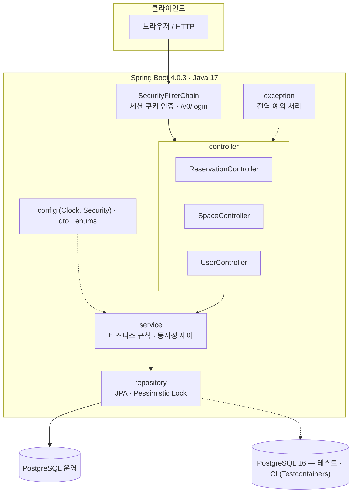
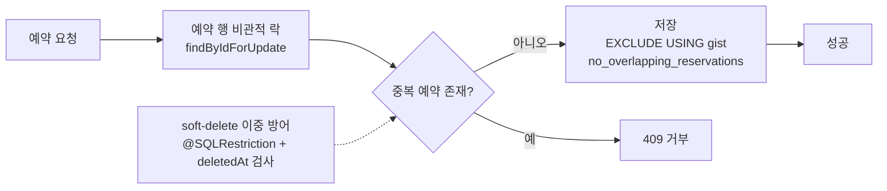

# 공간 예약 플랫폼 백엔드

시간 단위 공간 예약, 취소 및 공간 관리를 제공하는 백엔드 API입니다. 결제·정산은 현재 구현 범위에 포함되지 않습니다.
**중복 예약과 중복 취소 같은 동시성 문제를 락과 DB 제약으로 해결한 과정**을
중심으로 정리했습니다.

> [스페이스클라우드](https://www.spacecloud.kr)를 참고해 만든 개인 학습 프로젝트입니다.

## 기술 스택

- Java 17, Spring Boot 4.0.3
- Spring Data JPA, Spring Security (세션 기반 인증)
- PostgreSQL 16 (운영·테스트, Testcontainers)
- Gradle 9.3.1

## 아키텍처

### 레이어 구조



### 예약 동시성 처리



## 주요 기능

- 회원가입 · 로그인 · 로그아웃 (호스트 / 렌터 / 관리자 역할)
- 공간 · 서브스페이스(공간 하위 단위) 등록 및 관리
- 예약 생성 · 취소
- 호스트 · 렌터별 예약 목록 조회 (커서 기반 페이지네이션)
- 휴무일 규칙 관리, 예약 불가 시간 조회

## 동시성 문제 해결

이 프로젝트의 핵심입니다. 각 문제는 **재현 테스트 → 수정 → 검증** 순서로
GitHub 이슈·PR에서 관리했습니다.

### 1. 중복 예약 (race condition)

- **문제**: 중복 확인(SELECT)과 예약 저장(INSERT)이 원자적이지 않아, 두 트랜잭션이
  동시에 중복 확인을 통과하고 각자 저장할 수 있었습니다. PostgreSQL 기본 격리
  수준(READ COMMITTED)에서는 미커밋 행이 보이지 않습니다.
- **해결**: ① 대상 서브스페이스에 비관적 쓰기 락(`PESSIMISTIC_WRITE`)
  ② DB 수준 백스톱으로 `EXCLUDE USING gist` 제약
  — **애플리케이션에 버그가 있어도 DB가 막는 2중 방어**입니다.
- 참고: #11

### 2. 동시 취소 중복

- **문제**: 같은 예약에 취소 요청이 동시에 들어오면 취소가 여러 번 적용됩니다.
  10개 스레드로 재현한 결과 **성공 10 / 거부 0**이었습니다.
  (상태를 CONFIRMED로 읽고, 검사를 통과하고, 모두 커밋)
- **해결**: 예약 행에 비관적 쓰기 락을 걸어 상태 검사를 직렬화
  — 수정 후 **성공 1 / 정상 거부 9 / 예상 밖 실패 0**
- 검증: `CancelReservationControllerTest#concurrentCancel_shouldSucceedOnlyOnce`
- 참고: #36

### 3. Soft delete 경쟁 조건

- **문제**: 서브스페이스 삭제 시 예약 존재를 확인한 뒤 `deletedAt`을 기록하는
  사이에 다른 트랜잭션이 예약을 생성할 수 있었습니다.
- **해결**: 삭제 로직도 같은 락을 사용하도록 변경 (check-then-delete 원자화)
- 참고: PR #35

## 실행 방법

### 1. 요구사항

- Java 17, PostgreSQL

### 2. 환경변수

| 변수 | 설명 |
|---|---|
| `DB_URL` | JDBC URL (예: `jdbc:postgresql://localhost:5432/rent_a_space`) |
| `DB_USERNAME` | DB 사용자 |
| `DB_PASSWORD` | DB 비밀번호 |

### 3. 스키마 초기화

**스키마는 자동 생성되지 않습니다.** 아래 스크립트를 직접 실행해야 합니다.

```bash
psql -h localhost -U <user> -d <dbname> -f src/main/resources/rent-a-space.sql
```

이 스크립트에는 `btree_gist` 확장 생성과 `no_overlapping_reservations`
EXCLUDE 제약이 포함되어 있습니다.

### 4. 실행

```bash
./gradlew bootRun
```

## 테스트

```bash
./gradlew test
```

테스트는 Docker가 필요합니다. Testcontainers가 PostgreSQL 16 컨테이너를 띄우고
`application-test.yml`의 `ddl-auto: create-drop`으로 스키마를 생성합니다.

운영 DDL(`src/main/resources/rent-a-space.sql`)은 `ProductionSchemaContractTest`가
그대로 적용해 `btree_gist` 기반 `EXCLUDE` 제약과 취소 예약 predicate를 검증합니다.

```bash
docker info   # Docker 데몬 확인
./gradlew test
```

## 알려진 제한

- 애플리케이션 테스트의 스키마는 Hibernate가 생성하므로 운영 DDL과 완전히 같지는
  않습니다. PostgreSQL 전용 제약은 `ProductionSchemaContractTest`가 운영 DDL로
  별도 검증하며, 스키마 일원화는 Flyway 도입 시 정리합니다.
- 스키마 초기화가 수동입니다. 마이그레이션 도구(Flyway) 도입 예정입니다.
- Lombok 의존성 제거 진행 중입니다. (#14)
- `docker-compose.yml`이 없어 로컬 환경을 직접 준비해야 합니다.
