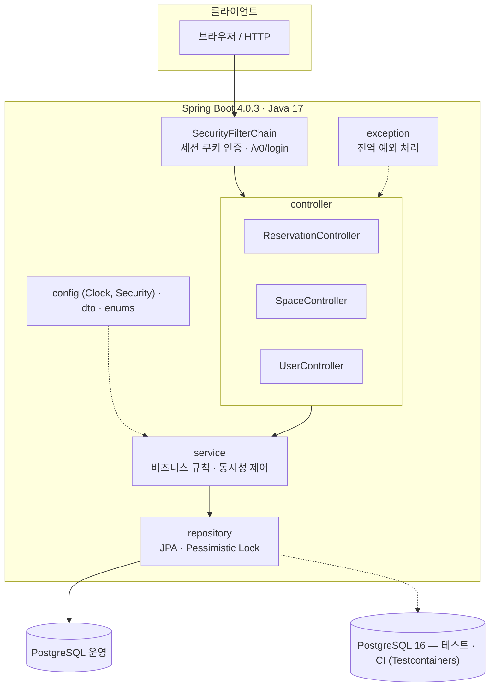
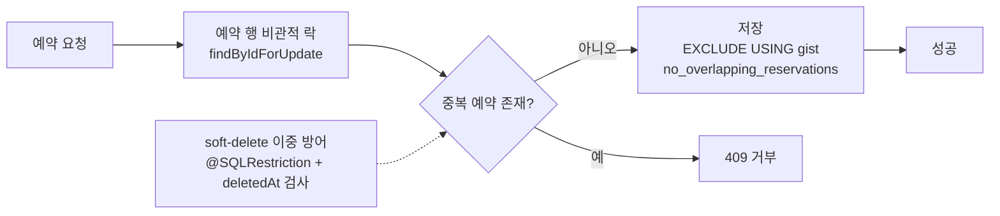

# 공간 예약 플랫폼 백엔드

시간 단위 공간 예약, 취소 및 공간 관리를 제공하는 백엔드 API입니다. 결제·정산은 현재 구현 범위에 포함되지 않습니다.
**중복 예약과 중복 취소 같은 동시성 문제를 락과 DB 제약으로 해결한 과정**을
중심으로 정리했습니다.

> [스페이스클라우드](https://www.spacecloud.kr)를 참고해 만든 개인 학습 프로젝트입니다.

## 30초 요약

시간 단위로 공간을 예약하는 백엔드입니다. 핵심은 **중복 예약과 중복 취소를 애플리케이션 락과
PostgreSQL 제약으로 이중 방어**한 것입니다. 결제·정산은 범위에서 제외했습니다.

| 증거 | 값 | 어디서 확인하나 |
|---|---|---|
| 테스트 | **112개 통과** (14 클래스, PostgreSQL 16 Testcontainers) | `./gradlew test` |
| HTTP 스모크 | **16단계 통과** — 가입 → 공간 생성 → 예약 → 중복 409 → 취소 → 재취소 409 | `./scripts/smoke-test.sh` |
| 동시 취소 10건 | 수정 전 **성공 10 / 거부 0** → 수정 후 **성공 1 / 거부 9** (서비스 계층 직접 호출) | `CancelReservationControllerTest#concurrentCancel_shouldSucceedOnlyOnce` |
| DB 백스톱 | `EXCLUDE USING gist` — 애플리케이션에 버그가 있어도 겹치는 예약은 저장되지 않음 | `ProductionSchemaContractTest` |

- 3분 안에 실행: [실행 방법](#실행-방법)
- API 21개 엔드포인트의 실측 요청·응답: [docs/api.md](docs/api.md)
- 왜 비관적 락인가, 무엇을 검증하지 *못했는가*: [docs/technical-decisions.md](docs/technical-decisions.md)

## 기술 스택

- Java 17, Spring Boot 4.0.3
- Spring Data JPA, Spring Security (세션 기반 인증)
- PostgreSQL 16 (운영·테스트, Testcontainers)
- Gradle 9.9.0

## 아키텍처

### 레이어 구조



### 예약 동시성 처리



## 주요 기능

- 회원가입 · 로그인 · 로그아웃 (호스트 / 렌터 / 관리자 역할)
- 공간 · 서브스페이스(공간 하위 단위) 등록 및 관리
- 예약 생성 · 취소
- 호스트 · 렌터별 예약 목록 조회 (커서 기반 페이지네이션)
- 휴무일 규칙 관리, 예약 불가 시간 조회

## 동시성 문제 해결

이 프로젝트의 핵심입니다. 각 문제는 **재현 테스트 → 수정 → 검증** 순서로
GitHub 이슈·PR에서 관리했습니다.

### 1. 중복 예약 (race condition)

- **문제**: 중복 확인(SELECT)과 예약 저장(INSERT)이 원자적이지 않아, 두 트랜잭션이
  동시에 중복 확인을 통과하고 각자 저장할 수 있었습니다. PostgreSQL 기본 격리
  수준(READ COMMITTED)에서는 미커밋 행이 보이지 않습니다.
- **해결**: ① 대상 서브스페이스에 비관적 쓰기 락(`PESSIMISTIC_WRITE`)
  ② DB 수준 백스톱으로 `EXCLUDE USING gist` 제약
  — **애플리케이션에 버그가 있어도 DB가 막는 2중 방어**입니다.
- 참고: [#11](https://github.com/joons5834/rent-a-space-api/issues/11)

### 2. 동시 취소 중복

- **문제**: 같은 예약에 취소 요청이 동시에 들어오면 취소가 여러 번 적용됩니다.
  10개 스레드로 재현한 결과 **성공 10 / 거부 0**이었습니다.
  (상태를 CONFIRMED로 읽고, 검사를 통과하고, 모두 커밋)
- **해결**: 예약 행에 비관적 쓰기 락을 걸어 상태 검사를 직렬화
  — 수정 후 **성공 1 / 정상 거부 9 / 예상 밖 실패 0**
- 검증: `CancelReservationControllerTest#concurrentCancel_shouldSucceedOnlyOnce`
- 참고: [#36](https://github.com/joons5834/rent-a-space-api/issues/36)

### 3. Soft delete 경쟁 조건

- **문제**: 서브스페이스 삭제 시 예약 존재를 확인한 뒤 `deletedAt`을 기록하는
  사이에 다른 트랜잭션이 예약을 생성할 수 있었습니다.
- **해결**: 삭제 로직도 같은 락을 사용하도록 변경 (check-then-delete 원자화)
- 참고: [PR #35](https://github.com/joons5834/rent-a-space-api/pull/35)

## 실행 방법

### 0. 한 번에 실행 (복사·붙여넣기)

Docker와 JDK 17이 있으면 아래 5줄이면 끝납니다. `--wait`는 Compose v2.17 이상에서 동작합니다.

```bash
docker compose up -d --wait
export DB_URL='jdbc:postgresql://localhost:5432/rent_a_space' DB_USERNAME=rent DB_PASSWORD=rent
docker compose exec -T postgres psql -v ON_ERROR_STOP=1 -U rent -d rent_a_space -f - < src/main/resources/rent-a-space.sql
docker compose exec -T postgres psql -v ON_ERROR_STOP=1 -U rent -d rent_a_space -f - < db/seed.sql
./gradlew bootRun
```

다른 터미널에서 `./scripts/smoke-test.sh`를 실행하면 `16 checks passed`가 나옵니다.
아래 1~6번은 같은 절차를 단계별로 설명한 것입니다.

### 1. 요구사항

- JDK 17
- Docker — PostgreSQL 16 컨테이너를 띄웁니다. Docker가 없으면 PostgreSQL 16과 `psql`을 직접 준비합니다.
- `btree_gist` 확장이 필요합니다. `postgres:16-alpine` 이미지에는 기본 포함되어 있습니다.
- `python3` — 동작 확인 스크립트가 JSON을 파싱할 때만 사용합니다.

### 2. PostgreSQL 실행

```bash
docker compose up -d
docker compose ps
```

`postgres`의 `STATUS`가 `Up (healthy)`가 될 때까지 기다립니다(보통 5초 안팎).

### 3. 환경변수

```bash
export DB_URL='jdbc:postgresql://localhost:5432/rent_a_space'
export DB_USERNAME=rent
export DB_PASSWORD=rent
```

`docker-compose.yml`에 적힌 개발용 계정입니다. 다른 DB를 쓴다면 값만 바꿉니다.

### 4. 스키마와 시드 데이터

**스키마는 자동 생성되지 않습니다.** 두 파일을 순서대로 적용합니다.

```bash
docker compose exec -T postgres psql -v ON_ERROR_STOP=1 -U rent -d rent_a_space -f - < src/main/resources/rent-a-space.sql
docker compose exec -T postgres psql -v ON_ERROR_STOP=1 -U rent -d rent_a_space -f - < db/seed.sql
```

- `src/main/resources/rent-a-space.sql`: 테이블·인덱스, `btree_gist` 확장, `no_overlapping_reservations` EXCLUDE 제약
- `db/seed.sql`: 공간 카테고리(`meeting`, `practice`, `studio`, `party`)

카테고리와 이미지는 만드는 API가 없습니다. 카테고리는 `db/seed.sql`로 넣고, 공간 이미지는 지금은 비워 둡니다
(이미지 URL을 보내려면 `images` 테이블에 같은 URL이 먼저 있어야 하고, 없으면 `400`입니다).

로컬 PostgreSQL을 직접 쓴다면 `psql -h localhost -U rent -d rent_a_space -f <파일>`로 바꿔 실행합니다.

### 5. 애플리케이션 실행

```bash
./gradlew bootRun
```

`Tomcat started on port 8080`과 `Started RentASpaceApiCloneApplication in ... seconds` 로그가 나오면 준비가 끝났습니다.

### 6. 동작 확인

다른 터미널에서:

```bash
./scripts/smoke-test.sh
```

회원가입 → 로그인 → 공간·서브스페이스 생성 → 예약 → 중복 예약 409 → 취소 → 재취소 409 를 실제 HTTP로
호출하고 상태 코드를 검사합니다. 16개 검사가 모두 통과하면 아래처럼 출력됩니다.

```
PASS  HOST 회원가입
PASS  HOST 로그인 (세션 쿠키 저장)
PASS  공간 생성 (HOST)
PASS  서브스페이스 생성 (HOST)
PASS  공간 목록 (공개, category=meeting)
PASS  목록에 생성한 공간이 포함됨
PASS  공간 공개 상세 (공개)
PASS  RENTER 회원가입
PASS  RENTER 로그인 (세션 쿠키 저장)
PASS  예약 생성 (RENTER)
PASS  겹치는 예약은 409
PASS  예약 상세 (RENTER)
PASS  예약 취소 (RENTER)
PASS  이미 취소된 예약 재취소는 409
PASS  호스트 예약 목록 (HOST)
PASS  쿠키 없는 렌터 목록은 401

16 checks passed
```

## API

전체 요청·응답 예시와 오류 메시지는 [docs/api.md](docs/api.md)에 있습니다. 아래는 경로와 권한 요약입니다.

- 인증은 **세션 쿠키** 기반입니다. `POST /v0/login`의 `Set-Cookie`를 이후 요청에 그대로 보냅니다.
  CSRF 토큰은 없습니다.
- 요청·응답 필드는 모두 snake_case입니다.
- 목록 API는 `limit`(기본 10) + `next_cursor` 커서 페이지네이션을 씁니다.

| 메서드 | 경로 | 권한 | 설명 | 성공 |
|---|---|---|---|---|
| POST | `/v0/users` | 공개 | 회원가입 | 201 |
| POST | `/v0/login` | 공개 | 로그인, 세션 쿠키 발급 | 200 |
| POST | `/v0/logout` | 로그인 | 로그아웃 | 200 |
| POST | `/v0/users/{id}/roles` | 본인·ADMIN | 역할 추가 | 201 |
| GET | `/v0/spaces` | 공개 | 공간 목록 (카테고리 필터, 커서) | 200 |
| GET | `/v0/spaces/{id}` | 공개 | 공간 공개 상세 | 200 |
| POST | `/v0/spaces` | HOST·ADMIN | 공간 생성 | 201 |
| GET | `/v0/host/spaces/{id}` | 소유 HOST·ADMIN | 공간 관리용 상세 | 200 |
| PATCH | `/v0/spaces/{id}` | 소유 HOST·ADMIN | 공간 수정 | 200 |
| POST | `/v0/spaces/{id}/subspaces` | 소유 HOST·ADMIN | 서브스페이스 생성 | 201 |
| GET | `/v0/host/subspaces/{id}` | 소유 HOST·ADMIN | 서브스페이스 관리용 상세 | 200 |
| PATCH | `/v0/subspaces/{id}` | 소유 HOST·ADMIN | 서브스페이스 수정 | 200 |
| GET | `/v0/subspaces/{id}` | 공개 | 서브스페이스 공개 상세 (비공개는 404) | 200 |
| DELETE | `/v0/subspaces/{id}` | 소유 HOST·ADMIN | 서브스페이스 soft delete | 200 |
| GET | `/v0/subspaces/{id}/unavailable-dates?year=&month=` | 로그인 | 휴무일 조회 | 200 |
| GET | `/v0/subspaces/{id}/unavailable-hours?date=` | 로그인 | 예약 불가 시간 조회 | 200 |
| POST | `/v0/reservation` | RENTER | 예약 생성 (중복은 409) | 201 |
| GET | `/v0/host/reservations` | HOST | 호스트 예약 목록 | 200 |
| GET | `/v0/renter/reservations` | RENTER | 렌터 예약 목록 | 200 |
| GET | `/v0/reservation/{id}` | 관련자·ADMIN | 예약 상세 | 200 |
| DELETE | `/v0/reservation/{id}` | 관련자 | 예약 취소 (재취소는 409) | 200 |

이 프로젝트의 핵심인 예약 중복은 같은 본문을 두 번 보내면 확인할 수 있습니다.

```bash
curl -o /dev/null -w '%{http_code}\n' -b renter-cookies.txt \
  -X POST http://localhost:8080/v0/reservation \
  -H 'Content-Type: application/json' \
  -d '{"subspace_id":1,"starts_at":"2026-12-10T10:00:00","ends_at":"2026-12-10T12:00:00","renter_name":"김렌터","renter_phone":"01087654321","renter_email":"docs.renter@example.com"}'
```

첫 요청은 `201`, 같은 본문을 다시 보내면 `409`가 나옵니다.

## 테스트

```bash
./gradlew test
```

테스트는 Docker가 필요합니다. Testcontainers가 PostgreSQL 16 컨테이너를 띄우고
`application-test.yml`의 `ddl-auto: create-drop`으로 스키마를 생성합니다.

운영 DDL(`src/main/resources/rent-a-space.sql`)은 `ProductionSchemaContractTest`가
그대로 적용해 `btree_gist` 기반 `EXCLUDE` 제약과 취소 예약 predicate를 검증합니다.

```bash
docker info   # Docker 데몬 확인
./gradlew test
```

## 알려진 제한

- **테스트 스키마와 운영 DDL이 같지 않습니다.** 애플리케이션 테스트 스키마는 Hibernate가 만들고,
  PostgreSQL 전용 제약은 `ProductionSchemaContractTest`가 운영 DDL(`src/main/resources/rent-a-space.sql`)을
  그대로 적용해 따로 검증합니다. 스키마 일원화는 Flyway 도입 시 정리합니다.
- **스키마 초기화가 수동입니다.** 마이그레이션 도구 없이 `psql -f`로 적용합니다.
- **카테고리·이미지를 만드는 API가 없습니다.** 카테고리는 `db/seed.sql`로 넣고, 이미지 URL은
  `images` 테이블에 먼저 있어야 공간·서브스페이스에 붙일 수 있습니다.
- **ADMIN 프로필은 가입 시 비활성(`enabled = false`)으로 생성되고, 활성화 API가 없습니다.**
  `UPDATE users_profiles SET enabled = true WHERE user_id = <id> AND role = 'ADMIN';`로 켭니다.
